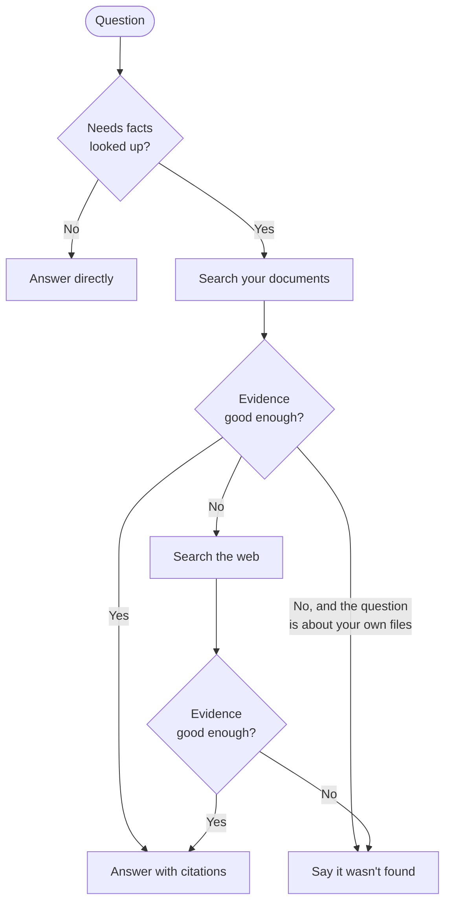

# Agentic RAG

A multi-user app for asking questions about your own documents. An agent searches your
private knowledge base first, has an LLM grade whether the evidence is good enough, falls
back to web search when it isn't, and answers with numbered citations. If it can't find
enough evidence, it says so instead of guessing.

## Features

- **Agentic retrieval:** a LangGraph workflow decides whether to search, what counts as good
  evidence, and when to go to the web.
- **Cited answers:** each answer links to its sources and says where it came from: your
  documents, the web, or both.
- **Visible reasoning:** every decision the agent makes is streamed to the browser as it happens.
- **Private by user:** accounts with hashed passwords and login tokens, and each user can only
  search their own documents.
- **Most common file types:** PDF, Word (`.docx`), PowerPoint (`.pptx`), Excel (`.xlsx`, `.xlsm`),
  CSV, HTML, Markdown, plain text and source code. Scanned PDFs need OCR first.
- **One-command deployment:** a single Docker container serves the API and the frontend.

## How it works



- Questions that refer to your own files ("my CV", "the report I uploaded") never go to the web.
- The web search covers only what your documents couldn't answer, and the grader is instructed
  to keep private details out of the query.
- A question can be answered partly from your documents and partly from the web.

## Tech stack

| Part | Technology |
|---|---|
| Backend | Python 3.13, FastAPI, LangGraph, LangChain |
| LLM | Groq (`openai/gpt-oss-120b` for answers, `openai/gpt-oss-20b` for routing and grading) |
| Embeddings | `all-MiniLM-L6-v2` (sentence-transformers), running locally on the CPU |
| Vector store | Qdrant, either Qdrant Cloud or a local on-disk database |
| Web search | Tavily |
| Accounts | SQLite, scrypt password hashing, JWT login tokens valid for 7 days |
| Frontend | Next.js 16, React, TypeScript, Tailwind CSS |

## Getting started

You'll need a [Groq](https://console.groq.com) API key and a [Tavily](https://tavily.com) API
key. [Qdrant Cloud](https://cloud.qdrant.io) is optional.

Clone the repository, then create a file called `.env` in the project root:

```env
GROQ_API_KEY=your-groq-key
TAVILY_API_KEY=your-tavily-key
JWT_SECRET=a-long-random-string

# Optional. Leave both out to use a local Qdrant database.
QDRANT_URL=https://your-cluster.qdrant.io
QDRANT_API_KEY=your-qdrant-key
```

`JWT_SECRET` signs login tokens. To generate one:

```bash
python -c "import secrets; print(secrets.token_urlsafe(48))"
```

`.env` is ignored by git, so your keys stay out of the repository.

### Option 1: Docker (recommended)

Requires [Docker](https://www.docker.com/products/docker-desktop/) with Compose.

```bash
docker compose up --build -d     # then open http://localhost:8000
docker compose logs -f           # follow the logs
docker compose down              # stop, keeping your data
```

The first build takes a while and produces an image of about 2.5 GB, because it includes
PyTorch and the embedding model. The container can take up to a minute to become ready.

To use another port, add `PORT=9000` to `.env`.

Accounts, uploaded files and the local Qdrant database (if you use one) are kept in the
`app-data` volume, so they survive restarts and rebuilds. `docker compose down -v` deletes them.

### Option 2: Run locally for development

Requires [uv](https://docs.astral.sh/uv/) and Node.js 22. Use two terminals:

```bash
# Terminal 1: backend, from the project root
uv run uvicorn agentic_rag.api:app --reload --port 8000
```

```bash
# Terminal 2: frontend
cd frontend
npm install
npm run dev
```

Open http://localhost:3000. The interactive API docs are at http://localhost:8000/docs. The
embedding model is downloaded the first time the backend starts.

The frontend expects the backend at `http://localhost:8000`. To change that, set
`NEXT_PUBLIC_API_URL` in `frontend/.env.local`.

## Configuration

Set these in `.env`. Only the first three are required.

| Variable | Default | Purpose |
|---|---|---|
| `GROQ_API_KEY` | required | Groq API key |
| `TAVILY_API_KEY` | required | Tavily API key |
| `JWT_SECRET` | required | Signs login tokens |
| `QDRANT_URL` | not set | Qdrant server to use; if not set, a local database is used |
| `QDRANT_API_KEY` | not set | API key for that server |
| `QDRANT_COLLECTION` | `documents` | Collection name |
| `QDRANT_PATH` | `qdrant_data` | Folder for the local database |
| `QDRANT_TIMEOUT` | `60` | Qdrant request timeout, in seconds |
| `GROQ_ANSWER_MODEL` | `openai/gpt-oss-120b` | Model that writes answers |
| `GROQ_GRADER_MODEL` | `openai/gpt-oss-20b` | Model that routes questions and grades evidence |
| `MAX_UPLOAD_MB` | `20` | Largest file a user can upload |
| `MAX_CHUNKS_PER_USER` | `10000` | Storage limit per user |
| `USERS_DB` | `users.db` | SQLite database for accounts |
| `UPLOAD_DIR` | `uploads` | Folder for uploaded files |
| `FRONTEND_ORIGINS` | `http://localhost:3000` | Comma-separated origins allowed by CORS |

The local Qdrant database handles one request at a time. Use a Qdrant server if several people
will use the app at once.

## API

Every endpoint except `/health`, `/auth/register` and `/auth/login` needs an
`Authorization: Bearer <token>` header.

| Method | Path | Description |
|---|---|---|
| `POST` | `/auth/register` | Create an account and get a token |
| `POST` | `/auth/login` | Log in and get a token |
| `GET` | `/auth/me` | Current user |
| `GET` | `/documents` | List your documents and storage usage |
| `POST` | `/documents` | Upload files; streams progress as server-sent events |
| `DELETE` | `/documents/{file_name}` | Delete a document |
| `POST` | `/chat` | Ask a question; streams agent steps and the answer as server-sent events |
| `GET` | `/health` | Health check |

Uploading a file with the same name as an existing one replaces it.

## Project layout

| Path | Role |
|---|---|
| `src/agentic_rag/api.py` | FastAPI endpoints |
| `src/agentic_rag/agent.py` | LangGraph workflow |
| `src/agentic_rag/decision.py` | LLM routing and evidence grading |
| `src/agentic_rag/document_loader.py` | Reads each supported file type |
| `src/agentic_rag/chunker.py` | Splits documents into overlapping chunks |
| `src/agentic_rag/embeddings.py` | Sentence-transformers embeddings |
| `src/agentic_rag/vector_store.py` | Qdrant: per-user storage, limits and deletion |
| `src/agentic_rag/tavily_search.py` | Web search |
| `src/agentic_rag/llm.py` | Groq model setup |
| `src/agentic_rag/auth.py` | Accounts and login tokens |
| `frontend/` | Next.js app |
| `Dockerfile`, `compose.yaml` | Container build and run |
